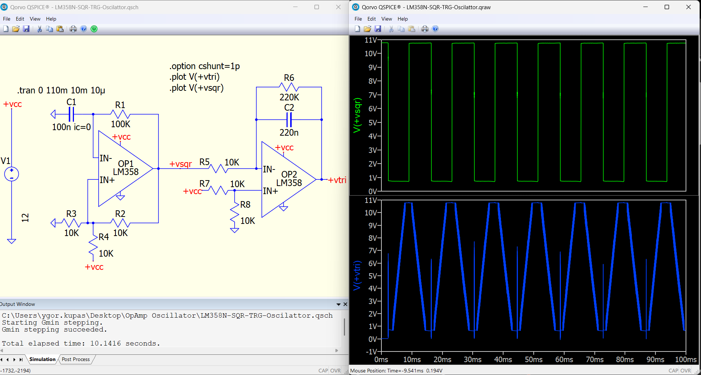
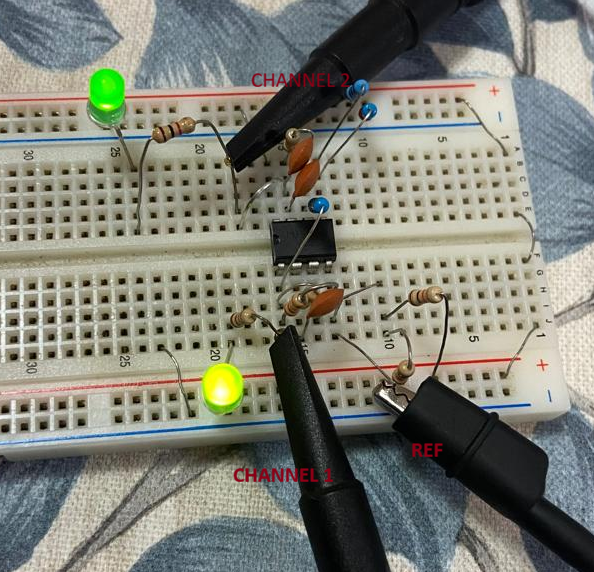
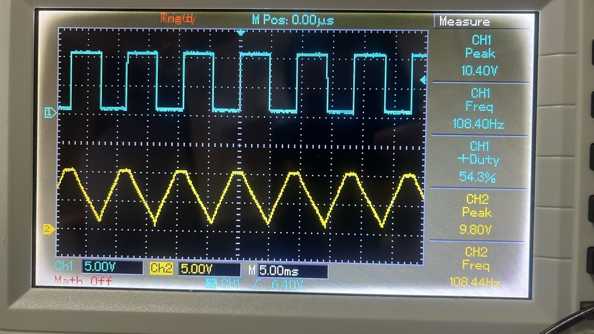

# OpAmp-Square-Triangle-Wave

Project of a square and triangle wave using OpAmp LM358N, in Qspice simulation and breadboard.

## Qspice Simulation

## Breadboard Circuit

## Real Circuit Results

